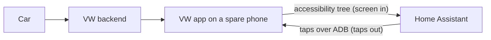
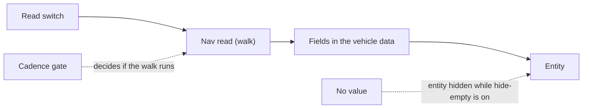
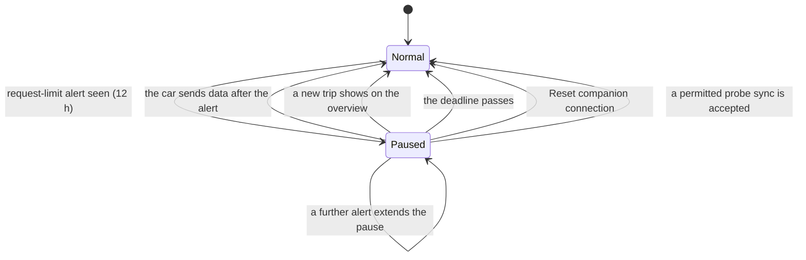
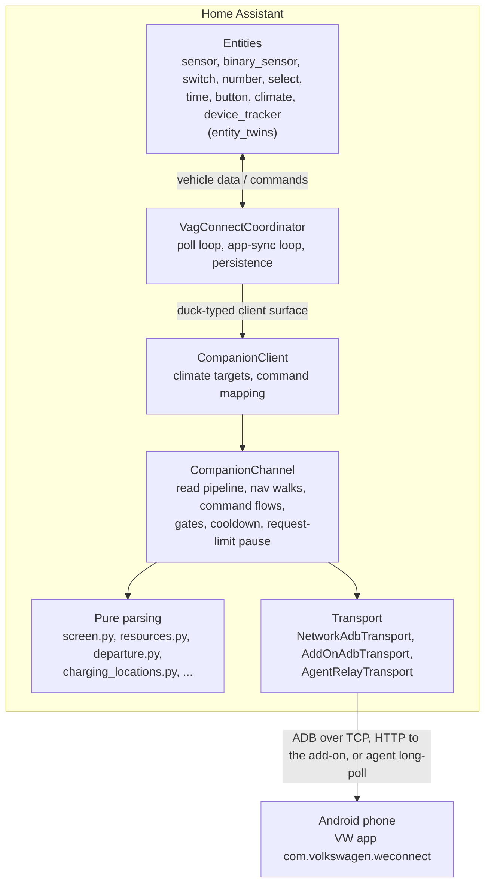

# Volkswagen Companion (ADB): functional and technical design

The Companion channel reads, and for a short list of controls operates, the genuine
Volkswagen app on a spare Android phone, and turns what the app shows into Home
Assistant entities. This document is the single entry point for how it works: what
you get, how the entities relate to each other, how it polls, what it is allowed to
send to the car, how it is built, and where it is known to be weak.

| | |
|---|---|
| **Applies to** | the first release after 4.13.0 |
| **Baseline app** | VW app **4.6.4** (`com.volkswagen.weconnect`); 4.3.2 is still read-compatible |
| **Status** | experimental, opt-in; Volkswagen only is verified |
| **Credit** | The channel, its transport, selectors and navigation are Prash Balan's ([@its-me-prash](https://github.com/its-me-prash)). The VW app 4.6.4 mapping, the controls, the extra reads and the safety gates described here were developed in [gszigethy/vwgroup-connect-ha](https://github.com/gszigethy/vwgroup-connect-ha). App captures came from @plainmad (Mk8 Golf GTE), @kgroshert (ID.4, e-up!), @WEZANGO (CUPRA Born) and @gszigethy (Tiguan eHybrid), and the prior art of @ckomma. |

> [!NOTE]
> The Companion is **experimental and opt-in**. Only Volkswagen is verified, on VW app 4.6.4 (and 4.3.2 for reads). Everything that taps the
> phone is off until you switch it on, and every control is checked on screen before and after it taps.

Wording used throughout: **walk** is one trip through the app's screens (tap in, read,
come back). **Dump** is one `uiautomator dump` of the screen. **Pause** is the 12 h
backoff after the car's request-limit alert. **Field** is a name in the integration's
vehicle data (for example `electric_range_km`); an **entity** is what Home Assistant shows.

## Contents

1. [Overview](#1-overview)
   - [1.1 What the Companion is](#11-what-the-companion-is)
   - [1.2 Design principles](#12-design-principles)
   - [1.3 Scope and brand status](#13-scope-and-brand-status)
   - [1.4 Document map](#14-document-map)
2. [Functional design](#2-functional-design)
   - [2.1 What you get](#21-what-you-get)
   - [2.2 Setting it up](#22-setting-it-up)
   - [2.3 The entities](#23-the-entities)
   - [2.4 How the entities depend on each other](#24-how-the-entities-depend-on-each-other)
   - [2.5 Polling and refresh behaviour](#25-polling-and-refresh-behaviour)
   - [2.6 Commands](#26-commands)
   - [2.7 The car's request budget](#27-the-cars-request-budget)
   - [2.8 Departure times, charging locations and charging rules](#28-departure-times-charging-locations-and-charging-rules)
3. [Technical design](#3-technical-design)
   - [3.1 Architecture](#31-architecture)
   - [3.2 Code map](#32-code-map)
   - [3.3 The read pipeline](#33-the-read-pipeline)
   - [3.4 Navigation reads](#34-navigation-reads)
   - [3.5 Language independence](#35-language-independence)
   - [3.6 The command pipeline](#36-the-command-pipeline)
   - [3.7 State, persistence and caching](#37-state-persistence-and-caching)
   - [3.8 Concurrency and lifecycle](#38-concurrency-and-lifecycle)
   - [3.9 Transports](#39-transports)
   - [3.10 Security model](#310-security-model)
   - [3.11 Tests and fixtures](#311-tests-and-fixtures)
   - [3.12 Extending the Companion](#312-extending-the-companion)
4. [Limits and timings](#4-limits-and-timings)
5. [Quirks of the VW app](#5-quirks-of-the-vw-app)
6. [Known issues](#6-known-issues)
7. [Troubleshooting](#7-troubleshooting)
8. [Evidence, sources and credits](#8-evidence-sources-and-credits)

---

## 1. Overview

[↑ Contents](#contents)

### 1.1 What the Companion is

The data path is:

Home Assistant brings the VW app to the front on a phone it can reach over ADB, dumps
the visible screen as XML, reads values out of it, and, when asked, taps the app's own
controls. The whole contract is **screen in, taps out**.

> [!IMPORTANT]
> **No root, no app tokens, no traffic interception.** The Companion sees only what the VW app draws on the phone's screen.

- **No root, no tokens, no traffic.** The Companion does not read the app's storage or
  credentials, does not intercept network traffic and stores no VW login. The phone is
  already signed in. The entry stores the ADB key (`<config>/.storage/vag_connect_adbkey`), any add-on or agent token, and any S-PIN typed into the setup form (which the Companion does not use).
- **Why it exists.** Volkswagen's backends are increasingly closed to third parties, and the EU Data Act portal delivers a thin slice of data (no GPS and no commands on VW EU cars; see the README's Known limitations). On the cars this fork targets, the app shows more than those channels and accepts commands they do not. The Companion is a last-resort channel for that.
- **Trade-offs.** It is slow (a walk takes seconds to tens of seconds), fragile against
  app updates (hence the version gates in [3.6](#36-the-command-pipeline)), it needs a
  phone that stays reachable, and its commands spend the car's request budget
  ([2.7](#27-the-cars-request-budget)).

### 1.2 Design principles

These are the rules the code is held to. They explain most of the behaviour below.

1. **Screen in, taps out.** Besides screen navigation the Companion only does the transport and app-lifecycle work listed in [3.9](#39-transports): waking the display, starting or force-stopping the app, reading the app's resource table, and a temporary dump file. A read taps only the navigation needed to reach a screen and presses BACK to leave.
2. **A separate stream.** Companion values feed the same fields the VW cloud parser
   (`cariad/api/vw_eu.py`) fills for the same value, and never a field that only the
   EU Data Act portal fills. Cloud and EU Data Act parsers are not changed for the
   Companion; the few shared-code fixes are listed in the changelog. Where the cloud has no equivalent (departure-timer weekdays, charging
   locations) the Companion has its own fields.
3. **Read before tap, read back after tap.** Every control is verified on screen. A screen that is not the expected one stops the walk, and a staged change is cancelled where the cleanup succeeds, so it is not carried into the next command. A mismatch stops further action; a request that an earlier tap already sent (a moved climate dial) cannot be recalled.
4. **No device pixels.** Tap points come from nodes in the live dump and from the dp
   scale measured on that phone, never from coordinates measured on one device. This was
   checked on other display densities (320, 420, 560 dpi).
5. **Language independent.** Labels are matched against the installed app's own string
   table (`resources.arsc`), so the resource-based readers work in any app language (some navigation paths, such as the parking position, still use English or German labels). English and German patterns stay as a fallback. A value that cannot be read generally stays unknown rather than being estimated; the one deliberate interpretation is a row reading "2 zones", taken as both front zones.
6. **Fail closed.** Writes need a listed build, and forward reads a listed or newer one; an unreadable version or an unverified preset disables taps (closing a nag screen aside). An empty or contradictory screen leaves the last values as they were.
7. **Spare the car.** Navigating the app is not observed to wake the car (VW does not document it). Commands and the *Synchronise now* tap are what spend its request budget, and they are rate-limited and paused after the car refuses.
8. **One value, one entity.** Where a control exists, the read-only entity that would
   repeat it is not created ([2.4](#24-how-the-entities-depend-on-each-other)).
9. **Opt-in for depth.** Every walk beyond the overview has its own switch, off by
   default. A deeper walk never rides along on a shallower opt-in.

### 1.3 Scope and brand status

| Brand preset | Status |
|---|---|
| **volkswagen** | Verified on a real device. Reads, nav reads and controls. This document is about this preset. |
| audi, skoda, seat, cupra | Unverified (`verified=False`), no nav reads and no actions. They read what the overview narrates and **refuse every tap and every control** until a confirmed screen map from a real device exists. CUPRA's overview selectors already come from a real-device dump. |

Not offered at all: **lock and unlock**. See [2.6](#26-commands).

### 1.4 Document map

The Companion documentation was written in pieces during development. This document
supersedes them as the place to start; the others stay as references.

| Document | Use it for |
|---|---|
| **This document** | Functional and technical design, limits, quirks, known issues. |
| [COMPANION_APP_MAP.md](COMPANION_APP_MAP.md) | Screen-by-screen map of the VW app: what each screen shows, which app string keys identify it, which field each value feeds, and a status per value. The reference to read before changing a selector. |
| [COMPANION_AGENT.md](COMPANION_AGENT.md) | Specification of the agent relay protocol (a phone app that calls Home Assistant). **No agent app exists**; the Home Assistant side ships only as a specification and an endpoint. |
| [COMPANION_BATTERY.md](COMPANION_BATTERY.md), [COMPANION_CLIMATE.md](COMPANION_CLIMATE.md) | The original write-ups of the battery and Air Conditioning mappings, with their evidence and credit tables. Their behaviour is now described here. |
| [FAQ.md](FAQ.md#-companion-adb-phone-the-app-wont-navigate-after-it-wakes) | The phone that does not wake or navigate (lock screen). |
| [CHANGELOG.md](../CHANGELOG.md) | What changed per release. |
| `tests/fixtures/companion_*/sources.json` | Provenance of every screen dump used in tests. |

---

## 2. Functional design

[↑ Contents](#contents)

### 2.1 What you get

**Reads** (phone navigation only; navigation is not observed to wake the car):

| Read | Switch needed | What it adds |
|---|---|---|
| Overview | none | Battery level, electric and petrol range, charging state, lock, climate state, *Last vehicle sync*, *App request status* |
| Charge detail | Read charge detail | Charge limit, charging power, speed and remaining time, charging method |
| Vehicle Health and Settings | Read Vehicle Health & Settings | Odometer, service and oil-service due, warnings, *Automatically release AC connector*, the vehicle-wide charge limit |
| Climate detail | Read climate detail | Climate and window-heating state, target and outside temperature, remaining time, start mode |
| Climate settings | Read climate settings | Climate at unlock, automatic window heating, climate zones |
| Departure times | Read departure times | The three climate timers: on/off, time, days, Repeat |
| Charging locations | Read charging locations | Up to five charging locations with their timers and settings |
| Driving data | Read driving data | Last trip and trip since charging or refuelling |
| Parking position | Read parking position | Latitude and longitude of the parked car |

**Controls** (each one taps the app and is verified on screen): start/stop charging, charge limit,
start/stop climate and window heating, desired temperature and start mode, four Climate Settings
switches, departure timers (switch, time, days, Repeat), *Refresh vehicle data*, and an optional
*Vehicle sync interval*. All controls are listed in [2.6](#26-commands).

### 2.2 Setting it up

**What you need**

- A spare Android phone with the VW app installed, **signed in, with the car selected**.
- The phone must stay reachable and be able to show the app. A phone that locks its screen
  or goes to sleep returns empty dumps; see the options below and the
  [FAQ](FAQ.md#-companion-adb-phone-the-app-wont-navigate-after-it-wakes).
- A dedicated phone is strongly advised: a walk drives the screen, and using the app on the
  same phone at the same time can disturb it.

**Three ways to reach the phone**

| Transport | How it works | When to use it |
|---|---|---|
| **ADB over TCP** (built in) | Home Assistant opens ADB to the phone's address (default port 5555) with an RSA key it creates under `.storage` in the config directory. The phone asks once to authorise that key. | Phones that accept classic network ADB. |
| **ADB Bridge add-on** ([vwgroup-app-adb-bridge](https://github.com/its-me-prash/vwgroup-app-adb-bridge)) | The add-on holds the connection (including Android 11+ wireless debugging, which needs pairing the built-in transport cannot do) and Home Assistant talks to it over HTTP (default port 8129, with a token). | Modern phones. Tick *use add-on* and give the add-on's address. |
| **Agent relay** | A phone app would call Home Assistant. **Specification only, no agent app exists.** | Not usable yet. See [COMPANION_AGENT.md](COMPANION_AGENT.md). |

**Adding the entry.** Add the integration, choose *Companion phone (ADB)* in the hub menu, and enter
the brand (default *volkswagen*), the phone's address and port (or the add-on's), and the VIN as the
app shows it. The setup form also has an S-PIN field and the add-on and agent options; the S-PIN is
**not used** by the Companion. ADB and add-on setup connects to the phone, reads the selected brand's app version and checks that the app is installed; relay setup only validates its token. New add-on setups need a token, and an agent token must be at least 32 characters with enough variety (a generated one is offered). The entry stores any S-PIN entered.

**After setup**

- Only the overview is read. Every deeper read is a switch on the *VW Group Connect Settings* device
  (entity ids on it look like `switch.adb_settings_read_…`); a switch applies on the next poll without a reload, turning it off clears the channel cache (some last-known values can remain through snapshot reconciliation), and the switches stay available in Read-only Mode.
- The same device holds the **Poll interval** slider and the **Vehicle sync interval** slider.
- *Configure* (options) has two phone options, both off by default: **wake the screen to poll**, and **close the app after each read** (force-stop, so the next poll starts the app fresh). ADB reads always wake the display; the first option additionally puts it back to sleep after each poll and enables the nightly interval doubling.
- *Read-only Mode* (a general integration option) creates no control entities; reads continue.

### 2.3 The entities

Names below are as Home Assistant shows them without the car's name in front (for example *Battery
Level* is `sensor.<car>_adb_battery_level`). Naming rules are at the end of this section.
Charge Target, Automatic window heating and Climate at unlock are in **Controls**; climate zones,
the Read switches, intervals and Reset stay in **Configuration**.

**Overview, read on every poll (no switch)**

| Entity | Platform | Notes |
|---|---|---|
| Battery Level | sensor | From the overview tile where the app narrates it; on builds that do not, from the charge sheet (needs *Read charge detail*). |
| Electric Range | sensor | Miles are converted. |
| Fuel Range | sensor | Plug-in hybrids and combustion cars only; its presence enables the combustion entities. The petrol **percentage** is not in the captured PHEV layout; the parser reads it if a layout narrates it ([6](#6-known-issues)). |
| Charging Status | sensor | The app's text, or a canonical value mapped from its translated labels (for example *Currently charging*, *Target charge level reached*, conservation charging). |
| Doors Locked | binary sensor | Lock device class: **off means locked**. Read-only on purpose. |
| Climate control state | climate entity | Running state: from the tile's narration on the overview, and from the Start/Stop button on the climate sheet. |
| Last vehicle sync | sensor (timestamp) | A timestamp inferred from the app's *Synchronised … ago* text: when the car last sent data to the app. Only moves forward ([5](#5-quirks-of-the-vw-app)). |
| App request status | sensor (diagnostic) | *available* or *restricted* ([2.7](#27-the-cars-request-budget)); exists only outside Read-only Mode, and can be unknown until a sync result or a limit is recorded. |
| Last Update, Data source channel, Source: Companion app (ADB) | sensor, binary sensor | Where the data comes from; the label is the Companion transport. |

**Charge detail** (*Read charge detail*)

| Entity | Platform | Notes |
|---|---|---|
| Charge Target | number (Controls) | The app's *Target charge level* text is read from the charge sheet; the number is also the control ([2.6](#26-commands)). 50–100 % in 10 % steps. |
| Charging power, speed, remaining time | sensors | Only while the app shows them. "One hour and 40 minutes" counts as 100 min. |
| Charging Mode | sensor | The app's charging method (*Immediate charging*, *Charge for departure time*, *Charge at preferred times*, …) mapped to Home Assistant labels such as Manual, Timer and Preferred charging times. Read-only. |

**Vehicle Health and Settings** (*Read Vehicle Health & Settings*)

| Entity | Platform | Notes |
|---|---|---|
| Odometer | sensor | Miles are converted. |
| Next Service, Service In | sensors | Distance and days to the next service; oil service where the app shows it. |
| Warning Active, Vehicle Warning Messages | binary sensor, sensor | Warning header and the categories that carry a warning. |
| Auto Unlock When Charged | binary sensor | The vehicle-wide *Automatically release AC connector*. |
| Charge Target | number (Controls) | Vehicle Settings also holds *Charging up to*, read on **every** poll (it can change in the app at any time). |

**Climate** (*Read climate detail*, *Read climate settings*)

| Entity | Platform | Notes |
|---|---|---|
| Climate Control | climate (Controls) | The one place to run climate: on / off, the temperature, and the presets *Air conditioning* and *Window heating*. Mode and temperature are **held in Home Assistant** for the next Start ([2.4](#24-how-the-entities-depend-on-each-other)) and restored after a restart. Window heating alone counts as on. |
| Climate ETA | sensor | Remaining minutes; 0 when idle. |
| Target Temperature | sensor (diagnostic) | What the app's dial shows now. |
| Outside Temperature | sensor | |
| Climate at unlock, Automatic window heating, Climate zone front left / front right | switches (Controls) | The Air Conditioning Settings. |

**Departure times** (*Read departure times*)

| Entity | Platform | Notes |
|---|---|---|
| Departure Timer 1–3 | switch | Timer on/off. |
| Departure Timer 1–3 — Time | time | 24 h; the app sets minutes in 5-minute steps. |
| Departure timer 1–3 weekdays | sensor (diagnostic) | Home Assistant weekday codes, for example `mon,tue,wed,thu,fri`. |
| Departure timer 1–3 repeat | binary sensor (diagnostic) | Off means a one-time timer on one weekday. |
| Departure Timers Enabled | sensor | Count; set only when all three rows were on screen. |

The service `vag_connect.set_departure_timer` writes the same timers: `departure_time`, `recurring_on` for repeating weekdays, or `one_off_day` for a one-time timer (Repeat follows from that).

**Charging locations** (*Read charging locations*; read-only; all diagnostic)

| Entity | Platform | Notes |
|---|---|---|
| Charging location count | sensor | Locations read; set only after a complete read with at least one location. |
| Current charging location | sensor | Name of the location the car is parked in (the app's *Active* badge), or `none`. |
| Charging location N (N = 1–5) | sensor | The name, in the app's list order. |
| … N active timers | sensor | The app's "N active departure times" text. |
| … N timer M (M = 1–3): enabled, time, weekdays | binary sensor, sensors | Time 24 h; days from the row's recurrence label. |
| … N active | binary sensor | The car is parked there. |
| … N reduced AC charging current, automatically release AC connector | binary sensors | The location's own settings. |

Slots that were never read create no entities. The two charge-level sliders of a location are not
readable ([5](#5-quirks-of-the-vw-app)).

**Driving data** (*Read driving data*): last trip distance, duration, average speed, average fuel
and electric consumption; and the same set since charging or refuelling (distance, drive time,
average speed, average fuel, average energy).

**Parking position** (*Read parking position*): the **Location** device tracker. It is read from the
share preview of the app's map, and nothing is shared.

**Buttons**

| Entity | What it does |
|---|---|
| Refresh app screen data | Reads now, including every detail screen that is otherwise gated. |
| Refresh vehicle data | Taps *Synchronise now* once and re-reads the app 3 minutes later ([2.5](#25-polling-and-refresh-behaviour)). Wakes the car. |
| Reset companion connection | Clears the failure cooldown and the request-limit pause and reads at once. |

All three are in the device's Configuration section: they maintain the data and do not operate the car.

**Naming and ids**

Moving the three controls out of Configuration changes no names, unique ids or entity ids.

- **Unique ids** of companion entities are `{vin}_companion_{key}`, a namespace of their own, so a car
  that is also set up through the EU Data Act portal does not drop the Companion's entities as
  duplicates. A one-time migration kept existing entity ids and history.
- **Entity ids** of newly created companion entities carry the tag `adb` (`sensor.tiguan_adb_battery_level`)
  so they cannot be mistaken for the cloud entry's `sensor.tiguan_battery_level`. Entity **names** carry
  no tag. Entities created earlier keep their ids.
- Entities on the *VW Group Connect Settings* device can have either `adb_settings_…` or
  `vw_group_connect_settings_…` ids, depending on when they were created. They are the same device.
- Cloud-only diagnostics (push event, API observer findings, wake count today) are not created on a
  companion entry.
- Where the companion needs another name or section for a shared entity, it uses a companion subclass
  with the same unique id: `VagCompanionRefreshButton` (`button.py`) is the shared refresh button with
  the name *Refresh app screen data* and the Configuration category.

### 2.4 How the entities depend on each other

**The read chain.** A value reaches an entity along one path:

| Nav read | Switch | Fields (examples) | Cadence |
|---|---|---|---|
| overview | — | `electric_range_km`, `is_charging`, `doors_locked`, `climatisation_active`, `companion_app_synced_at` | every poll |
| `charge_detail` | Read charge detail | `target_soc`, `charging_power_kw`, `charging_rate_kmh`, `remaining_charge_time_min`, `charge_mode` | every poll |
| `vehicle_health` | Read Vehicle Health & Settings | `odometer_km`, `service_km`, `service_due_in_days`, `warning_*` | when the car sent new data |
| `vehicle_settings` | (same switch) | `target_soc`, `auto_unlock_when_charged` | every poll |
| `climate_detail` | Read climate detail | `climatisation_active`, `target_temperature`, `outside_temp`, `climate_remaining_time_min` | every poll |
| `climate_settings` | Read climate settings | `climate_at_unlock`, `window_heating_enabled`, climate zones | every poll |
| `departure_times` | Read departure times | `departure_timer_N_enabled/_time/_weekdays/_repeat` | every poll |
| `charging_locations` | Read charging locations | `charging_location_*` (72 fields) | when a trip ended |
| `driving_data` | Read driving data | `last_trip_*`, `refuel_trip_*` | when a trip ended |
| `parking_position` | Read parking position | `latitude`, `longitude` | when a trip ended |

Climate detail and climate settings are read on one walk, and the Departure times list and the
charging locations share one trip into that screen. The exact gates are in
[2.5](#25-polling-and-refresh-behaviour).

**Twin entities.** A control and a read-only entity must not both show the same value. Where the
control exists the read-only entity is not created, and one left by an earlier version is removed:

| Control | Read-only entity it replaces |
|---|---|
| Climate at unlock, Automatic window heating, Climate zone switches | the binary sensors of the same names |
| Climate Control (climate entity) | window-heating and climatisation binary sensors, the climatisation state sensor, the *Climate Start Mode* sensor |
| Charging switch | the *Currently Charging* binary sensor |
| Charge Target number | the *Charge Target* sensor |
| Departure Timer switches and Time entities | the timer enabled binary sensors and time sensors |

Without the control (Read-only Mode, or a command the preset does not map) the sensor stays.

**Held values on the climate entity.** The climate entity's temperature and preset are stored in Home
Assistant, not written to the car. A climate Start sets the app's mode picker and dial from them, reads
both back, and presses Start only if they match. These rules keep them honest:

- The preset mirrors the app, where the picker is one-shot and falls back to air conditioning after a
  stop. *Window heating* chosen while off applies to the next Start only: once a window-heating run has
  been seen and has ended (Stop, the car's timer or the app), the preset returns to *Air conditioning*. A
  choice never started is kept. While climate runs, the preset shows what runs and cannot be changed.
- A dial changed in the app moves the held temperature too (the app saves every dial change to the
  car). A value set in Home Assistant applies until the app's dial changes again.
- While the air conditioning **runs**, changing the temperature moves the app's dial at once (one car
  request per gesture, at most two gestures, so at most 2 °C per change). With the climate off, or
  running window heating alone (the app disables the dial), the change is only stored for the next Start.

**Charge target: three places, one number.** The Companion has one *Charge Target* number, fed by two
reads and written through one control:

| Where in the app | Meaning | Readable | Writable |
|---|---|---|---|
| Charge sheet, *Target charge level* | What the app shows as the target now | yes (*Read charge detail*) | no |
| Vehicle Settings, *Charging up to* | The vehicle-wide limit | yes (every poll, with the health switch) | **yes**, this is the control |
| Each charging location, *Charging up to* | The limit while the car is parked there | **no** (canvas-drawn) | no |

> [!WARNING]
> Treat *Charge Target* as the **vehicle-wide** limit. While the car is parked at a saved charging location, that location's own limit applies, and it cannot be read.

The app states its own precedence under *Charging up to*: "This setting does not apply to charging
sessions at specified charging locations." So while the car is parked at a saved location, the
location's value applies, not the number Home Assistant shows and sets. Whether the charge sheet then
shows the location's value or the vehicle-wide one is **not confirmed**: both are 80 % on the test car,
and the app code suggests the location's value is shown when a remote flag is on. Treat *Charge
Target* as the vehicle-wide limit.

**The synchronisation cluster.** Five things belong together:

- *Vehicle sync interval* (0 = off, 60–240 min in steps of 5) taps *Synchronise now* on a timer. The
  interval counts from the newest of the last sync attempt, the car's last data (*Last vehicle sync*) and
  the last command tap. A car that sent data on its own, for example while driven, therefore gets no tap
  until a full interval after that data. The last two survive a restart, so after a Home Assistant restart
  an overdue sync runs right away, a recent one is waited out, and a restart never wakes the car by itself.
  With neither known (a new entry), the first sync waits a full interval.
- *Refresh vehicle data* is one such tap on demand. Both restart the same interval clock, so the two
  never wake the car minutes apart.
- *Last vehicle sync* is the timestamp of the car's data, inferred from the app's age text. It is also what the walk gates
  watch ([2.5](#25-polling-and-refresh-behaviour)): a sync counts as "new car data".
- *App request status* is the outcome of the last sync attempt or the pause ([2.7](#27-the-cars-request-budget)).
- *Refresh app screen data* re-reads but does not sync.

**The pause cluster.** A request-limit alert in the app sets a 12 h pause. During it every control and every sync is refused (a pause identified as the local power-budget alert allows one probe sync per 4 h), and *App request status* reads *restricted*. The pause ends when the car sends new data after the alert (it was started or woke up) or the overview shows a new trip, at its deadline, on *Reset companion connection*, or when a permitted probe is accepted.
Reads continue, but see [5](#5-quirks-of-the-vw-app) for what the app shows meanwhile.

**Freshness and availability.** Values read from a detail screen are cached. A value not refreshed by a successful read for **24 hours** becomes unavailable ; the entity's `companion_read_at` attribute is
the time the screen was read (not when the car last sent data). Expiry adds no navigation and no car
request. Values from the overview are not cached this way; an overview that cannot be read leaves the
last known values visible. After a restart, entities are restored from the last snapshot until the
first read completes.

**Coexistence with the EU Data Act (and any other cloud) entry.** The same VIN can be read by an EU Data
Act entry and by the Companion at once. They are separate streams: separate unique ids, separate
entity ids, and a visible source label. Neither feeds the other.

**Read-only Mode.** Control platforms (switch, number, button, select, time, climate) are not created
for controls; sensors, binary sensors, the tracker and the read switches stay (*App request status*, which exists only for writable entries, is omitted).

### 2.5 Polling and refresh behaviour

**The poll loop.** One loop per entry reads the app every *Poll interval*: a slider of 5–240 minutes in steps of 5 (setup default 10), with a hard floor of 3 minutes. The first screen read after a start is deferred to the background loop and runs immediately; setup itself still connects to the transport. Unlike the cloud channels, the nightly doubling of the
interval (22:00–05:00) applies to the Companion **only** when the wake-the-screen option is on.

**What a poll does.** Wake the display, bring the app to the front (an already-foreground app is not
relaunched), check the app version and, when it changed, the string table; dump the overview; close any
alert or nag screen; confirm the overview is on screen; parse; then run the due walks.

**Which walks run on a poll**

| Walk | Runs |
|---|---|
| charge detail, vehicle settings, climate, climate settings, departure times | on every poll while their switch is on |
| Vehicle Health | when the Driving data tile text changed, or when the inferred sync time has moved past its rounding since the last Health walk **and** is at least 10 minutes old (so a car still sending while driving is read once it has parked) |
| Driving data, parking position, charging locations | when a **trip ended**: the overview's Driving data tile text changed; or the car sent new data and the electric or petrol range dropped while not charging (this catches two identical trips) |

Every gated walk **also** runs: on the first poll after a start or reload, when its switch is turned on,
every 12 hours, on *Refresh app screen data*, and on the read that follows *Refresh vehicle data*. Trip walks also
run every 6 hours while the Driving data tile is not on the overview.

**Sync and read-back.** An accepted scheduled sync is followed 3 minutes later by an ordinary refresh (the car needs time to answer); *Refresh vehicle data* additionally forces every opted-in detail walk at that read. A refused sync is read at once so *App request status* shows why.

**When the phone fails.** A failure in the initial read stage (connect, foreground, version, first dump: phone off, ADB gone, secured screen) starts a cooldown of 30 minutes that doubles per consecutive failure up to 6 hours; during it the poll does nothing and is not counted as a failed poll. Failures inside a detail walk are skipped without a cooldown. A broken ADB connection ("Broken pipe") is reopened on the next read. *Reset
companion connection* clears the cooldown. An overview that cannot be recognised (a stray screen, a nag
that cannot be closed) yields no values rather than wrong ones, and the last values stay.

### 2.6 Commands

**Preconditions, for every command.** Most controls pass the shared command gate ([3.6](#36-the-command-pipeline)); climate controls have their own gate with the same rules. A command is refused, before its first control tap, when:

- Read-only Mode is on;
- the preset is not verified, or the app version cannot be read, or the build is **not listed** for that
  command (see the table; newer builds keep reads, never commands);
- the request-limit pause is running (except one probe sync per 4 h);
- less than 60 s have passed since the previous command (also after a restart);
- the app's string table is unavailable and the UI language cannot be confirmed as English, German or
  Spanish (the request-limit alert could not be recognised);
- the app is not on the overview, or shows an alert instead.

**Controls**

| Control (entity or service) | What it does in the app | Listed builds | Checks |
|---|---|---|---|
| Charging switch, start/stop charging | Opens the charge sheet and taps Start or Stop once. A greyed-out Start is never pressed | 4.6.4, 4.3.2 | The CTA's disabled hint is checked (Compose can report `enabled=true`); the next poll supplies the real state |
| Charge Target number | Vehicle Settings → moves the *Charging up to* slider (50–100 %, steps of 10) → Save | 4.6.4, 4.3.2 | Each slider tap is read back from the row's "NN %"; up to 3 taps; unreachable → the app's X cancels, nothing is sent; Save is accepted when the synchronisation ends and the overview returns, or when the Settings row shows the target without a Save button |
| Climate Control (climate entity: on / off, preset) | Air Conditioning sheet → Start or Stop (mode picker only to switch to or from window-heating-only) | 4.6.4, 4.3.2 | Mode and dial read back before Start; off is the app's single Stop, which ends either mode; a preset change while running is refused; an unknown mode refuses Start |
| Climate temperature on a running climate | Moves the dial: one step is a tap on the next label, two steps one slow drag | same | The dial must show °C and be inside 15.5–30 °C; read back after every gesture; more than 2 °C is refused before anything moves |
| Climate at unlock, Automatic window heating, Climate zones | Air Conditioning Settings → toggle → Save | 4.6.4 | The page is read back; a value already in place sends nothing |
| Departure Timer switches | Taps the row's switch (the app sends at once) | 4.6.4, 4.3.2 | Watched for a flip back (the car did not accept it) |
| Departure Timer time, `set_departure_timer` | The timer's page: time wheels, weekdays, Repeat → Save | 4.6.4 | Saved only when the page shows exactly what was asked; the timer is matched by content; two timers with the same time are refused; `enabled: false` with an edit is refused (Save switches the timer on) |
| Refresh vehicle data, Vehicle sync interval | Vehicle Settings → *Synchronise now* | 4.6.4, 4.3.2 | A power-budget pause allows one probe per 4 h; a backend pause allows none |

**How a command runs.** One command at a time, sharing the screen lock with polls. The channel brings
the app forward, refreshes the version gate, passes the gate above, taps along the shortest path, reads
every step back, and returns with the app's own up or close controls where there are any (Android BACK is the fallback, since from a shallow stack it can leave the app). After a command only the cache of the paths it touched is dropped; other paths keep their cadence.

**What "accepted" means.** A tap is not a confirmed vehicle result. Climate Start/Stop count as accepted when the sheet closes or the button flips; charging Start/Stop count as delivered when no request-limit alert is detected. The real state comes from the next poll. A command that meets the app's
request-limit alert trips the pause and fails with a reason that says to start the car.

> [!NOTE]
> **Lock and unlock are not offered, deliberately.** The lock state is a read-only sensor.

**Lock and unlock are not offered, deliberately.** Unlocking needs the S-PIN, which would have to be typed
into the phone over ADB and stored in Home Assistant; the app's lock control is a slider with no stable
target; a misread tap sends the opposite command; and repeated attempts risk an S-PIN lockout and spend
the car's budget. The lock state is a read-only sensor. If your brand's backend supports remote lock, use
that channel.

### 2.7 The car's request budget

> [!WARNING]
> Commands and *Synchronise now* wake the car and spend its daily request budget. *Vehicle sync interval* is **off by default**, never turned on by an upgrade, and has a 60 minute minimum.

Each remote request wakes the car and spends part of a **daily power budget** that protects its 12 V battery. When it is used up, the app answers a tap with an alert instead of the screen:

- **"Too many requests sent to the vehicle"**: the daily power budget (the app's resource comments associate it with backend error 4295);
- **"Request limit reached"**: an HTTP 429 from the backend (again per the app's resource comments).

Both say that starting the car makes everything available again. The app shows no number for the budget,
only these flags.

- **What spends it.** Commands and *Synchronise now* (each sync wakes the car), and the app's own
  background wake-ups. Reading screens is not observed to spend it (VW does not document this). By the app's own logic (APK
  analysis, not independently confirmed on the car) it also wakes the car on its own at most every 3
  hours, and every 12 hours when the 12 V battery is weak.
- **How it is detected.** The alert titles are read from the installed app's string table
  (`alert_daily_power_budget_title`, `dialog_maxrequests_headline`, `dialog_maxrequest_bff_error_headline`),
  so they are recognised in any app language; "Request limit reached" is also in the English fallback.
- **What happens.** Either alert, even when it draws late, starts a **12 h pause**: controls and syncs are
  refused, *App request status* shows *restricted*, the alert is closed, and the screen behind it is
  read. The pause and the 60 s command gap are persisted and survive a restart (an account lockout must
  not be cleared by a restart). *Reset companion connection* clears the pause.
- **New car data ends it.** Both alerts say that starting the car makes everything available again. When
  the overview's sync time ("Synchronised … ago") shows the car sent data after the pause began, the
  pause ends and *App request status* returns to *available*. The earliest time the rounded line can mean
  is used, so a sync from before the alert never ends it. A new trip on the Driving data tile ends it too
  (the engine ran); the tile as first read during the pause is the baseline, so a trip that ended before
  the alert never ends it. Neither check sends anything to the car.
- **Probing.** A pause identified as the local power-budget alert lets one sync probe through per 4 hours, so the integration notices the car coming back; there is no fixed quota, and a further alert extends the pause. A backend "too many requests" pause, an ambiguous alert, and a pause restored after a restart allow none.
The pause as a state machine:

- **Sync interval warning.** The *Vehicle sync interval* slider exists to keep the app's data fresh, but
  every tap spends budget. It is off by default, never turned on by an upgrade, and has a 60 min minimum.

### 2.8 Departure times, charging locations and charging rules

How Volkswagen modelled it, from the app (4.6.4 and its code), the API model and live captures. Items
marked *inferred* come from the app's code and on-screen texts; the car's firmware does the real
arbitration and was not observed.

- **Climate timers are car-wide.** The three timers under *Air Conditioning* (`climatisationTimers`)
  preheat to the chosen temperature wherever the car is.
- **Charging locations are places the car knows.** The Tiguan app's own text says to create them in the car's
  infotainment (up to five) and shows what the car reports; per-location departure times need location data
  switched on in the car. The app
  marks the one the car is parked in with an *Active* badge (the car reports the id of the location it
  believes it is in, `vehiclePositionedInProfileID`, from GPS).
- **Each location is a self-contained package:** name, maximum charging current (the "reduced AC current"
  toggle), *Direct charging up to* (0–50 %; *inferred*: the level it charges straight to, before any timer),
  *Charging up to* (50–100 %), *Automatically release AC connector*, preferred charging times (edited only
  in the infotainment), and its own three charging timers. Location timers always repeat; their page has no
  Repeat switch.
- **Precedence (inferred):**
  1. **The charging method comes first**: *Immediate charging* ("departure times are not taken into
     account"), *Charge for departure time*, or *Charge at preferred times* ("only within your preferred
     charging times selected for this charging location"). The API stores one method per car; the app asks
     "How do you want to charge **at this location**?", which suggests it is per location.
  2. **The location beats the vehicle while parked there.** The active location's *Charging up to*,
     current limit and connector release apply; elsewhere the vehicle-wide *Settings* apply. The app says so
     under *Charging up to* (quoted in [2.4](#24-how-the-entities-depend-on-each-other)).
  3. **A charging timer runs only when the car is parked at its location.**
  4. **The minimum level comes before any timer**: the car charges straight to *Direct charging up to*,
     then waits for the timer or the preferred window to fill up to the target.
- **Consequence on the test car:** it is on *Immediate charging*, so its location timers do not hold
  charging back; it charges as soon as it is plugged in.

---

## 3. Technical design

[↑ Contents](#contents)

### 3.1 Architecture

The client imitates the surface the coordinator already expects from a cloud client (`authenticate`,
`get_vehicles`, `get_status`, `command_*`), so the channel slots in as one more data source; the coordinator adds only Companion-specific startup, scheduling and lifecycle handling. There is no network login: "authenticated" means the phone is signed in. It serves
**one VIN**, the one entered at setup.

### 3.2 Code map

Companion code is in `custom_components/vag_connect/companion/`. Pure parsing is separated from the
device so most of it is tested without hardware.

| Module | Responsibility |
|---|---|
| `client.py` | Coordinator-compatible adapter. Command mapping, the held climate targets (`ClimateTargets`), unload handling (`_CLOSE_WAIT_S` 60 s, `_SETTLE_S` 30 s). |
| `channel.py` | The core: read pipeline, nav-read walks and their gates, command flows, version gate, cooldown, request-limit pause, screen lock. |
| `presets.py` | Per-brand data: field selectors, actions, nav reads, overlays, `ACTION_TO_COMMAND`, verified versions. |
| `screen.py` | Parses `uiautomator dump` XML into nodes and resolves selectors. No device involved. |
| `resources.py` | Decodes the app's `resources.arsc` into a string table and holds the value parsers (battery, overview, climate, health, settings, departure, trips). |
| `departure.py` | Departure-times list rows and the timer page (time wheels, weekdays, Repeat). |
| `charging_locations.py` | Location list rows, recurrence labels, plural texts, location page and settings page. |
| `charge_target.py` | Charge-limit slider geometry from neighbouring nodes. |
| `climate.py`, `climate_settings.py` | Dial geometry and climate controller; Air Conditioning Settings page. |
| `app_sync.py`, `sync_time.py` | *Synchronise now* button; parsing of *Synchronised … ago* (units from the app's plurals). |
| `entity_twins.py` | The control-versus-sensor rules; the list of cloud-only diagnostics. |
| `transport.py`, `addon_transport.py`, `relay_transport.py`, `relay.py` | The three ways to reach the phone ([3.9](#39-transports)). |

Outside the package: `coordinator.py` (poll loop, app-sync loop and its due time from the car's sync time and
the persisted last tap (`_companion_sync_basis_age_s`), persistence of the pause, force refresh,
placeholders at startup), `entity_base.py` (availability and `companion_read_at`), `switch.py`, `number.py`,
`button.py` (the three companion buttons, all Configuration), `select.py`, `time.py`, `climate.py` (platform), `const.py` (options, limits, id helpers),
`config_flow.py` (setup and options).
`number.py` makes only Companion Charge Target a Control; `switch.py` puts the four Air Conditioning
Settings switches in Controls by key. Read switches, intervals and the refresh/reset buttons stay Configuration.
`climate.py` holds `VagCompanionClimate`: the presets, the restore of the held mode and temperature, and the
one-shot window-heating fallback. `companion/entity_twins.py` lists the climate entities it replaced
(`RETIRED_COMPANION_CLIMATE`), which are not created and are removed from the registry.

### 3.3 The read pipeline

One `read()` per poll, serialised with commands by a screen lock:

1. If in cooldown, return `None` (not a failed poll).
2. Connect if needed; wake the display; bring the app to the front (skipped if already frontmost).
3. Refresh the **version gate** and the **string table** (a successful table is cached by app version and splits; a failed extraction is retried with backoff, after 15 minutes and then hourly).
4. Dump the screen and **clear overlays** (up to 3 BACK presses on a nag; rating prompts are closed with
   BACK, never answered; the Google Maps consent is accepted only during the parking read).
5. If the screen is a request-limit alert: close it (and the generic "Vehicle data unavailable" that follows),
   trip the pause, and read the screen behind it.
6. If a sub-screen is up (behind a closed alert, or left by a cut-short walk), go home first. Never parse
   overview selectors off another page. If the overview anchor (`rangeTile`) is still absent, return `{}`.
7. Parse the overview: preset selectors, then resource-based parsers. Record the car's data age from the
   sync line. A sync time later than the start of a running request-limit pause (the deadline minus 12 h,
   so a pause restored after a restart counts too) ends the pause (`_lift_pause_on_new_car_data`), and so
   does a Driving data tile that differs from the first one read during the pause (`_lift_pause_on_new_trip`).
8. Run the **nav walks** that are due ([3.4](#34-navigation-reads)).
9. Back-fill from the **cache** (24 h) the values a non-due poll did not read.
10. Wake/sleep and close-app options run in a `finally`, also after a failure.

Return values mean different things: `None` = nothing done (cooldown, or an alert that could not be closed);
`{}` = a read ran but matched nothing; a dict = the matched fields.

### 3.4 Navigation reads

A `NavReadSelector` has a `name`, `steps` (how to reach the screen from the overview), `values` and
`resource_targets` (the fields it fills), `back_presses` (how far back to the overview), an `opt_in`
and a `cadence` (`poll`, `trip` or `car_data`).

- **Grouping.** A read whose path continues the previous one (the climate sheet, then its Settings; the
  Departure times list, then the charging locations) is read on the same walk: one trip in, one way out.
- **Back accounting.** The walk backs out exactly as far as it actually walked. A step not on screen must
  not press BACK for taps never made, or it would leave the app.
- **Extra readers.** Some reads open further pages: the departure walk opens each timer page for days and
  Repeat; the charging-locations walk opens a location (by its name text) and its settings page (by the
  structural icon right of the toolbar title) and checks that the page title and the settings chip match
  the location before reading. Taps are on name text and the icon only; never a switch, the *Active*
  badge, a slider or Save.
- **Gating (`_walk_reason`).** For `trip` and `car_data` reads: no earlier read, the 12 h refresh, or a changed trip tile (both cadences). `trip` reads add the 6 h rule while the tile is absent and a range drop with settled new car data; `car_data` (Health) also runs on settled new car data. The basis of the last walk (time, trip tile, sync time and its rounding, ranges) is kept per read.
- **Empty is not a result.** The charging-locations read treats a list without rows as "no information", not
  as "no locations" (the app shows the same empty state during a request-limit pause), and leaves every
  value as it was.
- **Clearing.** After a *complete* read, slots beyond the rows found are cleared; a partial walk keeps
  what it read. A slot whose name changed does not keep another location's values.

### 3.5 Language independence

The installed app's `resources.arsc` (base APK and language splits) is decoded into a table of string keys
to labels (`pm path`, `unzip -p … resources.arsc | gzip | base64` over the shell, decoded in Home Assistant),
including plural forms. Stable resource **names** identify things (`acc_vehicle_tab_label_departure_times`,
`vehiclesettingsscreen_automaticplugunlock`, `common_status_active`, …); the matching text is whatever the
installed translation says. The table is cached and refreshed on an app version or split change. Nothing
outside the app's public resources is read, and no root is used.

Without the table, reads fall back to English and German patterns, and commands and sync are refused
unless the language can be confirmed as English, German or Spanish. Fields that depend on English or German
words in the fallback stay unknown in other languages, never guessed: the *Active / Off / Autom.*
descriptions on the Air Conditioning sheet, the window-heating mode title, and "min" in the remaining time.
Language-independent: the running state on the climate sheet (from the button id), temperatures, the Settings switches, and most command steps (toggles by id, modes by picker position verified against the row's own title, the dial by geometry); selecting a climate zone needs the string table.

### 3.6 The command pipeline

Most commands pass `_command_gate` (climate commands use their own gate with the same rules), in this order: known action; preset writable; transport connected and
app in front; version gate refreshed; build listed for writes (`app_version_listed`, **not** the more lenient
`app_version_covered` used for reads); the action's own build list; request-limit pause (with the probe
exception); 60 s minimum gap; language/limit-detection prerequisite; overview on screen with overlays cleared.

- **Two version predicates.** *Reads and nav taps* accept any listed build **or a newer one** (the walk finds
  each control on screen by id or label and stops instead of tapping blind). *Commands* accept only listed
  builds, because the slider and dial are walked with geometry measured on those builds. An unreadable
  version disables taps altogether; plain overview reads continue.
- **Listed builds** for the VW preset (the ceiling for reads and the base for commands): 4.6.4, 4.3.2, 3.64.0, 3.63.2, 4.2.1 (We Connect reports its version
  inconsistently: the store's "4.3.2" and internal names like "3.64.0" ship the same accessibility tree).
  Every command narrows this further (4.6.4 and 4.3.2, or 4.6.4 only); see [2.6](#26-commands). Overlay dismissal and recovery to the overview can run before the final language check.
- **Serialised.** One command at a time, under the same lock as polls; a command waiting for a walk holds
  until it finishes.
- **Read-back everywhere.** Each tap's effect is read from the next dump; a mismatch stops the command and cancels staged changes where the cleanup succeeds. Earlier taps may already have sent a request (a moved climate dial), and cancellation is not guaranteed after a transport failure.
- **Errors** carry fixed reasons, never free text quoted from the screen, and the relay reports only fixed
  codes.

### 3.7 State, persistence and caching

| State | Where | Lifetime |
|---|---|---|
| Request-limit pause (`companion_rate_limit_until`) and last command time (`companion_last_write_at`) | config entry data | survives restarts |
| Held climate temperature and start mode, with the dial they were held against | restored state of the climate entity | survives restarts |
| Vehicle snapshot (last values, last vehicle sync time) | coordinator | restored on reload and start until the first read |
| Nav cache | memory | 24 h without a successful read, then the entity is unavailable |
| Per-field read times (`companion_nav_read_at`) | persisted with the vehicle snapshot | carried with restored values |
| Walk bases (what the last gated walk saw) | memory | until restart (then every gated walk runs once) |
| Failure cooldown | memory | adaptive, cleared by restart or the reset button |
| App string table | memory | until the app version or split list changes |
| ADB RSA key | `<config>/.storage/vag_connect_adbkey` | permanent |

### 3.8 Concurrency and lifecycle

- **One screen, one lock.** Polls and commands never interleave. Climate walks also hold the charge channel's
  lock where one exists.
- **Startup defers the first screen read.** Setup connects to the transport, seeds placeholder vehicles and returns; the first read runs in the background and loops.
- **Unload and reload.** Closing the client waits up to 60 s for a running walk. A walk that finishes during
  an unload must create nothing: the coordinator drops pushes once shutdown has started, and the dynamic
  entity spawner adds nothing while its entry unloads (otherwise stale entities tied to the dead coordinator
  keep old values and reject the reloaded entry's own as duplicates). A client that could not confirm the
  phone finished its last command makes the next client on the same phone wait 30 s before its first walk.
- **Background tasks** (sync loop, read-back) are tied to the config entry, and the idle sync loop re-checks its settings at most 60 s apart, so a slider change applies without a reload (a running sync and its 3-minute read-back delay the next check).

### 3.9 Transports

The three share the core screen interface; capabilities differ (see the relay below).

| Verb | Meaning |
|---|---|
| `dump_ui` | The visible tree as `uiautomator dump` XML. One shell round trip: delete the old dump file, dump (about 1.5 s; uiautomator waits for the UI to go idle), cat. A failed dump leaves no file, so a frozen screen is never parsed as live |
| `tap`, `swipe`, `key_back` | Gestures |
| `foreground_app`, `is_foreground`, `current_app_version` | App control and version (`dumpsys package … versionName`) |
| `app_resource_paths`, `battery_strings` | The string table ([3.5](#35-language-independence)) |
| `wake`, `sleep_if_enabled`, `force_stop_if_enabled` | The two phone options |
| `tap_burst` | A spaced run of taps for the rare case a gesture needs it; a shell script that stops when the gap between taps exceeds 0.7 s |

- **`NetworkAdbTransport`** uses `adb-shell` over TCP, with the blocking calls on a worker thread. It cannot
  do wireless debugging's TLS pairing.
- **`AddOnAdbTransport`** speaks HTTP to the ADB Bridge add-on's `/shell`.
- **Relay.** The agent protocol ([COMPANION_AGENT.md](COMPANION_AGENT.md)): `POST /api/vag_connect/companion_agent`
  with an `X-Agent-Token` header; one command in flight; a 25 s hold; a token resolves to exactly one entry
  (two entries with the same token fail closed); unknown tokens answer 404. **No agent app exists.** `AgentRelayTransport` has no resource extraction, no arbitrary shell, no tap bursts and no effective force-stop.
- A dump costs about a second or more over ADB. The channel keeps waits tight (two dumps to settle a screen)
  and uses one shell call per dump.

### 3.10 Security model

- **Scope.** Only the VW app is brought forward or driven. No root, no stored VW credentials, no app tokens, no
  traffic interception. The agent contract adds: restrict the service to the manufacturer app's package, and
  send the token to exactly one host.
- **Tokens.** New add-on setups require a token; agent tokens need at least 32 characters with enough variety and are compared in constant time; diagnostics redact the add-on token, the agent token and the phone's
  address.
- **Screen dumps are untrusted input.** A dump containing an XML DOCTYPE or ENTITY declaration is refused
  before parsing; text from the screen is never quoted into error messages; relay errors are fixed codes.
- **Unsafe by design, therefore absent:** lock/unlock, anything that needs the S-PIN, and answering the app's
  rating prompt or the "air conditioning using battery?" question.

### 3.11 Tests and fixtures

- Companion tests are `tests/test_companion_*.py` (and the older `test_968_*`). A **fake phone** renders captured
  layouts and reacts as the APK does; assertions cover which nodes are tapped, how many BACK presses, and what
  survives a failure.
- Fixtures are real read-only dumps in `tests/fixtures/companion_*/`. Each directory has a `sources.json` with the
  contributor, original file and note. Place names are redacted unless the user's own label.
- Tests cover safety properties explicitly: read-navigation tests forbid taps on write controls (a switch, the *Active* badge, a slider), while command tests deliberately exercise switches, sliders and Save; staged changes are cancelled; a screen from another brand or another page parses to nothing.
- CI runs pytest, ruff (also over `tests/`), mypy with the strictness flags in `ci.yml`, and hassfest. Live validation is separate and read-only
  (see [8](#8-evidence-sources-and-credits)).

### 3.12 Extending the Companion

To add a value or a screen:

1. **Capture first.** A read-only dump of the screen on the target app version, saved as a fixture with its
   provenance. Check the live tree: Compose often merges text into one `content-desc`, canvas-drawn text is not in
   the tree at all, and the same screen can look different during a request-limit pause.
2. **Prefer a resource key** (`resources.py`, `_SINGLE_KEYS`) over a literal; keep the English/German pattern only as
   fallback.
3. **Name the field** in `cariad/models.py` as a companion-only field unless the VW cloud parser already fills the same
   value, in which case use that field. Never a field only the EU Data Act portal fills.
4. **Add a `NavReadSelector`** (opt-in, cadence, `back_presses`, `resource_targets`), then the switch
   (`COMPANION_READS`), coordinator opt-in, option constant and translation.
5. **Entities.** Keep the value `None` when unread so no phantom entity appears; add the key to the hide-empty gates;
   translate in every language.
6. **For a control**: a verified action with a build list, a read-back at every step, the `_command_gate`, the twin rule,
   and a test that proves the unexpected-screen path sends nothing.
7. Update [COMPANION_APP_MAP.md](COMPANION_APP_MAP.md) and this document.

---

## 4. Limits and timings

[↑ Contents](#contents)

| What | Value | Why |
|---|---|---|
| Poll interval | slider 5–240 min, step 5 (setup default 10); hard floor 3 min | Screen walks are slow and tap a real phone |
| Nightly doubling (22:00–05:00) | only with *wake the screen* on | Fewer overnight screen wakes; a dedicated phone keeps its cadence |
| Vehicle sync interval | 0 (off) or 60–240 min, step 5; counted from the newest of the last attempt, the car's last data and the last tap, also across a restart | Each sync wakes the car and spends budget |
| Read-back after a sync | 3 min | The car needs time to answer |
| Gap between commands | 60 s, kept across restarts | Never drive into a backend limit |
| Request-limit pause | 12 h, persisted; ends early when the car sends data or a new trip shows after the alert | The car's daily power budget |
| Probe through a pause | one sync per 4 h while a local power-budget pause is identified (no fixed quota); none for a backend pause, an ambiguous alert, or after a restart | Notice the car coming back |
| Gated walks | on trip end or new car data; always every 12 h; trip walks every 6 h without the Driving data tile | Values only change then |
| "New car data" settle time | 10 min with an unmoving sync time | A car on the move sends data every few minutes |
| Cache lifetime of detail values | 24 h, then unavailable | Tolerate gaps without showing yesterday's value |
| Failure cooldown | 30 min, doubling to 6 h | A phone that is off is not retried forever |
| Overlay dismissal | 3 BACK presses | Then give up and return no values |
| Charge-limit slider | 50–100 %, 10 % steps; 3 tries, each read back; Save outcome waits up to 15 dumps | Slider has no node; geometry from neighbours |
| Climate dial | 15.5 (LO) – 30.0 (HI), 0.5 steps; 1 step = tap, 2 steps = one drag; at most 2 gestures (2 °C) per change; each gesture is one car request | The dial is a snapping pager that sends 1 s after it settles |
| Departure timer edits | minutes in 5-min steps; up to 16 day taps and 40 wheel taps, each read back | Spinner TimePicker |
| Charging locations | 5 (what the app's text allows) | Set in the car's infotainment |
| Unload | waits 60 s for a running walk; next client waits 30 s after an unconfirmed command | Never run two clients on one phone |
| Relay hold | 25 s; token ≥ 32 characters | Specification only |
| One dump | about 1–1.5 s over ADB | Why walks are kept short |

---

## 5. Quirks of the VW app

[↑ Contents](#contents)

What makes the app hard to read, observed live on 4.6.4 (and 4.3.2) and confirmed in the APK where noted.

**Screen reading**

- **Compose UI with merged semantics.** Tiles narrate themselves as `<label>. <value>. <hint>` in one
  `content-desc`. What the tree does not carry cannot be read.
- **Canvas-drawn controls have no node.** The charge-limit slider and the per-location *Direct charging up to* and
  *Charging up to* sliders (the design-system slider draws its notch labels itself and sets no semantics) are
  invisible to the dump. The charge slider's geometry is derived from its neighbours; the location sliders'
  **values cannot be read at all**. Other routes were checked and carry nothing: the slider card's text is never
  rendered, the info sheet is static, the settings screen's navigation argument is only the location id, the widget
  shows range and fuel only, release builds log no HTTP bodies, the app's external files hold only a map cache, and
  the EU Data Act feed of the test car does not deliver per-profile limits.
- **The window is `FLAG_SECURE`.** Screenshots come back empty. `uiautomator dump` still works.
- **`enabled=true` on disabled buttons.** A greyed-out *Start charging* can report enabled; its hint says to check
  the charging status. Hints are read.
- **PHEV overview omits the petrol percentage.** The tile draws "410 km, 49 %" but its description holds only the
  ranges. The key `…_petrol_level` exists in the app; the PHEV layout never uses it.
- **Battery percentage** is narrated on the overview on some builds and only on the charge sheet on others; during a
  request-limit pause the overview hides it.
- **Dumps fail on a busy screen.** uiautomator waits for the UI to go idle; a screen with running animation or a
  secured overlay returns nothing.

**Behaviour**

- **The climate dial is a snapping pager.** A tap on a neighbouring label animates one step, and a touch during the
  animation stops it, so taps cannot be chained (a burst moved a live dial one step only: 21 → 20 landed on 20.5). The
  app sends the value the dial settles on 1 s after it settles, and when the sheet closes, whether or not Start is
  pressed. Each settle is one car request.
- **The climate sheet closes by itself** once the app's request succeeded. Cars that only take a temperature at start
  lock the dial while running. Start can ask "Activate air conditioning using battery?" when unplugged; that changes a
  vehicle setting and is never confirmed.
- **Where Save is and what it does.** Moving the charge slider sends nothing; Save sends. A departure timer's **Save
  switches the timer on**. Climate Settings apply only on Save. A Battery Care note can appear over the charge-limit row
  and needs one BACK before Save.
- **The timer page shows no timer number.** Two timers with the same time cannot be told apart, so edits to them are
  refused. The spinner TimePicker steps by tapping the previous or next value button; minutes come in 5-minute steps.
- **Recurrence labels** are `Every day`, `Weekdays`, `Weekends`, a full day name for one day, or short names joined by
  commas; all from the app's own strings.
- **Synchronised … ago** is a rounded text ("4 hours 4 minutes"), so the car's data time is only known within that
  rounding, and only narrows without a sync. It is kept monotonic.
- **Synchronise now** is at the bottom of vehicle Settings under *Vehicle data*, directly above *Delete vehicle*; it is
  matched by id only.
- **Prompts.** An update of the app resets the Google Maps consent that the parking read needs (only the parking walk
  accepts it). A rating prompt appears and is closed with BACK, never answered.
- **Remote feature flags** (for example `DisplayTargetSocEnabled`) can change what a screen shows without an app update.
- **Version names are inconsistent**: the store's "4.3.2" and internal names like "3.64.0" are the same UI.

**The request limit**

- Opening a screen is not observed to wake the car, but when the backend or the car's budget refuses, **screens degrade**. During a
  pause the Departure times screen showed **no climate timers and no charging locations** (on two phones) and the
  "First, create your charging locations" text, which is also what a car with no locations shows. A "Vehicle data
  unavailable" popup follows the alert. The app's own capability flags (offline mode, disabled by user, location data off,
  power budget reached, battery low) pick which text the Departure times screen shows.

**Charging locations**

- A location's *Charging up to* overrides the vehicle-wide one while the car is parked there, and the app says so on the
  vehicle-wide setting's info text ([2.4](#24-how-the-entities-depend-on-each-other)).
- Location timers always repeat. The *Active* badge is a separate clickable control inside the row, which is why the walk
  taps the name text instead.
- **A location deleted in the car stays in the app until the app restarts.** The app keeps its location list for
  as long as it runs: a *Vehicle sync* or *Synchronise now* does not refresh it, only closing and restarting the app
  does (observed live). Until then the walk reads the deleted location like any other.

---

## 6. Known issues

[↑ Contents](#contents)

What the VW app itself does, and what follows from it. This list is about the app and the car's service, not about the state of this integration.

| Item | Detail |
|---|---|
| Per-location charge limits unreadable | The location sliders draw their values themselves, without text. No route found ([5](#5-quirks-of-the-vw-app)) |
| PHEV petrol percentage | Not shown by the app's PHEV layout, so it is never estimated |
| A request-limit pause empties some screens | After the car refuses requests, the Departure times screen shows no charging locations and the climate timers disappear, exactly as if none existed. An empty screen is therefore never taken as proof that the data is gone: the last readings stay until they expire (24 h) |
| Deleted charging locations linger | A location deleted in the car stays in the app's list, and so in the charging location entities, until the app is closed and restarted; a vehicle sync does not refresh it ([5](#5-quirks-of-the-vw-app)). The *close the app after each read* option restarts it every poll |
| Every tap is a car request | Climate dial gestures, Start/Stop, Save and charge commands each spend the car's daily request budget ([4](#4-limits-and-timings)) |
| The app is the only screen | Using the app on the same phone while a walk runs can disturb it |

---

## 7. Troubleshooting

[↑ Contents](#contents)

| Symptom | Likely cause | What to do |
|---|---|---|
| Setup: cannot connect | Wrong address/port, ADB not enabled, key not authorised | Enable network ADB, accept the authorisation prompt on the phone; on Android 11+ use the ADB Bridge add-on |
| Setup: needs the add-on / app not found | Wireless debugging only, or the VW app is not installed or not the right package | Use the add-on; install and sign in to the VW app |
| Empty reads, entities stay unknown | Phone asleep or locked, app not in front, secured screen | Turn on *wake the screen to poll*; on a **dedicated** phone disable the lock screen once ([FAQ](FAQ.md#-companion-adb-phone-the-app-wont-navigate-after-it-wakes)) |
| Everything stopped after an error | Failure cooldown (30 min, doubling to 6 h) | Press *Reset companion connection* |
| Controls missing | Read-only Mode, or a command the preset does not map | Turn Read-only Mode off; check the app version |
| "commands are off on app version …" | The build is newer than the listed ones: reads work, commands wait for verification | Wait for a release that lists the build, or reinstall a listed build |
| Commands refused: "backed off" / *App request status* = *restricted* | The car's request budget is used up | Start the car, or press *Reset companion connection* after it recovered |
| Charging locations, timers or health values vanish or freeze | A request-limit pause empties those screens; or the 24 h expiry passed | Wait for the pause; values return on the next successful walk |
| A switch's data never appears | The matching read switch is off | Turn it on; the walk runs on the next poll |
| Charge Target differs from the car | A saved charging location overrides the vehicle-wide limit while parked there | See [2.4](#24-how-the-entities-depend-on-each-other) |
| Duplicate-looking entities | Both an EU Data Act entry and the Companion read the same car | Intended; the Companion's ids carry `adb` |
| Parking position stops updating after an app update | The update reset the Google Maps consent | The opted-in parking walk accepts it again once it is shown |
| Entities unavailable after hours | Detail values not refreshed for 24 h | Check the phone, or the gate (a trip must end for trip walks) |

For a bug report: enable debug logging for `custom_components.vag_connect.companion`, note the app version and
whether the pause was active, and attach the integration's diagnostics (the phone address and tokens are redacted).

---

## 8. Evidence, sources and credits

[↑ Contents](#contents)

**Sources of the mapping**

- Live, read-only navigation of a Tiguan Life 1.5 l eHybrid on VW app 4.3.2 (2026-10-02, 2026-10-04, 2026-10-06) and on
  **4.6.4** (2026-10-07 to 2026-10-11). Captures are mostly navigation; some fixtures record settings edits made in the app (see each `sources.json`).
- Every dump attached to upstream issue #968 (@WEZANGO CUPRA Born; @kgroshert e-up! and ID.4, German; @plainmad Mk8 Golf GTE
  on imperial units) and the context of #1684.
- String keys from the installed APK's `resources.arsc`; behaviour (what is sent, when, the models) from the APK's decompiled
  code. APKs and decompiled code are **not** distributed. VW 4.3.2 base APK SHA-256
  `81a3719746dfc7c3ac035afb1cac23b08a24155d7dd910a87432a6d60bdaa7b1`; 4.6.4 base APK SHA-256
  `0278120a011d61d8937f472c5757eaa447bcffc2518512f25f7b38cde7e02916`.
- The prior art of @ckomma ([charge-app-connector-vw](https://github.com/ckomma/charge-app-connector-vw)) for the app's
  accessibility vocabulary.

**Validation boundary.** Fixture and fake-phone tests cover parsing, gates and the unhappy paths. Live validation on the test
car was read-only; commands that send something to the car were exercised against fake phones and recorded app behaviour.

**Where the evidence lives**

| What | Where |
|---|---|
| Per-fixture provenance | `tests/fixtures/companion_*/sources.json` |
| Battery tile evidence and credits | [COMPANION_BATTERY.md](COMPANION_BATTERY.md#evidence-and-contributor-credits) |
| Air Conditioning evidence and credits | [COMPANION_CLIMATE.md](COMPANION_CLIMATE.md#evidence-and-credits) |
| Screen map and per-value status | [COMPANION_APP_MAP.md](COMPANION_APP_MAP.md) |
| Release-by-release changes | [CHANGELOG.md](../CHANGELOG.md) |
| Upstream tracking issue | [#968](https://github.com/its-me-prash/vwgroup-connect-ha/issues/968) |
